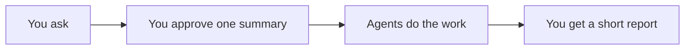

# ai-agents-setup

This repository holds wf, a personal workflow for Claude Code.

With wf, you describe a change you want in a project and approve one short summary. Then helper agents take over: one plans the work, others write the docs, write the code, test it and review it. At the end you get a short report.

Each task is sized by its difficulty and risk into a tier, from T0 to T5. Only the helpers that the task needs take part, so small jobs stay small.

wf is careful with your code. Nothing is committed, pushed or published unless the summary you approved asks for it.

For installation, daily use and every detail, read the visual guide in docs/guide/wf-guide.html.
