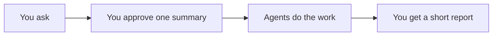
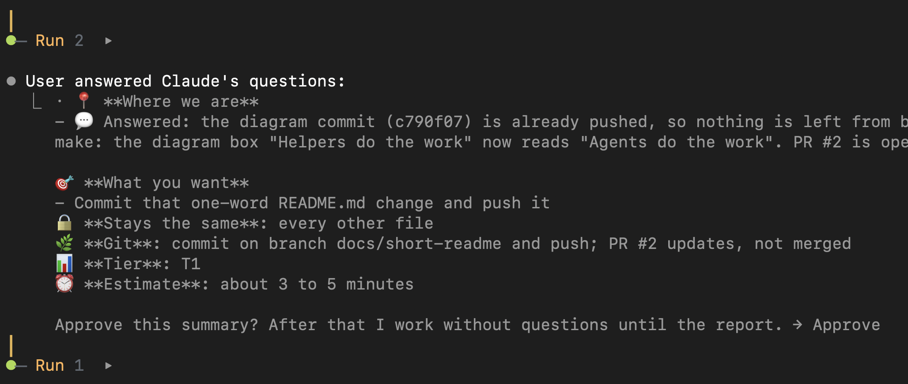

# ai-agents-setup

This repository holds wf, a personal workflow for Claude Code CLI.

With wf, you describe a change you want in a project and approve one short summary. Then helper agents take over: one plans the work, others write the docs, write the code, test it and review it. At the end you get a short report.





Each task is sized by its difficulty and risk into a tier, from T0 to T5. Only the helpers that the task needs take part, so small jobs stay small.

wf is careful with your code. Nothing is committed, pushed or published unless the summary you approved asks for it.

## Pre-commit checks

This repository ships a git pre-commit hook in `.githooks/`. Before each commit it runs `npm run lint` and `npm test`, and it blocks the commit when:

- an added line has an em dash or an en dash,
- an added line is a conflict marker,
- a staged file is under `.work/`.

A successful `node wf.mjs install` in a git clone sets the local `core.hooksPath` to `.githooks`, so no manual step is needed. Skip the checks for one commit with:

```sh
SKIP_TESTS=1 git commit -m "message"
```

Or skip the hook entirely with:

```sh
git commit --no-verify -m "message"
```

For installation, daily use and every detail, read the visual guide in docs/guide/wf-guide.html.
